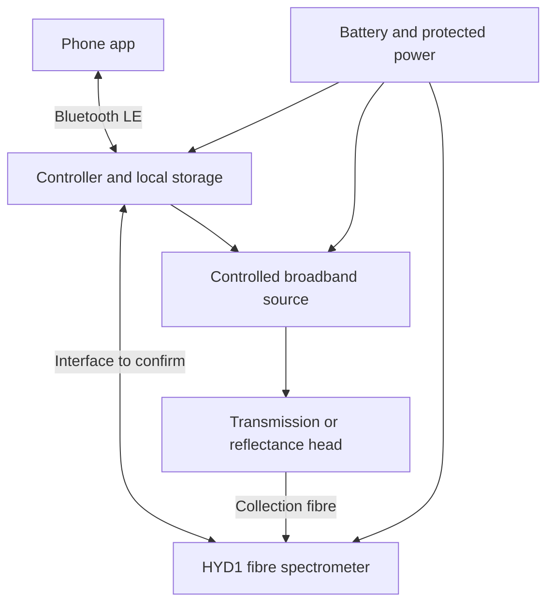

# A-2 system design

Status: concept for review, 27 November 2026. No PCB, thermal design or manufacturing CAD has been approved.

## System architecture

Physical optical paths, number of fibres, source geometry and switching between modes remain open. Diagram describes functions, not a finished wiring diagram.

## Optical concept

- **Transmission:** source and receiver on opposite sides of the leaf; capture dark and open-path reference with repeatable fixtures.
- **Reflectance:** source and receiver on the same side of the leaf; keep geometry fixed and use an appropriate characterised reference standard. Decide on angle, aperture, specular rejection and reference positioning by experiment.
- Select a source and optics with usable output across the **confirmed** HYD1 range. Determine fibre numerical aperture, aperture, coupling, stray light and signal-to-noise experimentally. Source, detector, fibre and diffuser have wavelength-dependent behaviour.
- If using the previously proposed 6 V 10 W halogen capsule, model and measure heat, warm-up and current; metal/ceramic lamp mounting and protected cool-side plastics are required. Lamp choice remains open.

## Controller and communication

Bluetooth is the selected phone link. An ESP32-family module supporting Bluetooth Low Energy (BLE) and a phone app are the initial implementation proposal. Confirm target phone operating systems and controller BLE support. Select an exact module after memory, storage and interface needs are measured. The HYD1 supplier's TTL-to-RS485 module is included in the reported kit; confirm which interface and signal levels the sensor and supplied board expose. RS485 is not a direct 3.3 V UART connection.

Local nonvolatile storage must survive reset, handle full storage safely and preserve saved records. Design authenticated pairing, bonding, device ownership and a physical recovery/re-pair procedure; choose pairing method based on actual input/output capabilities, without assuming a display or keyboard. Confirm suitable time source and explicitly identify uncertain timestamps.

## Power and packaging

Rechargeable battery, protective circuit, charging, regulation, power switch, branch protection and thermal cutoff are required design functions; exact parts and wiring are unresolved. Budget peak startup, continuous load and regulator losses. Charging port and user touch temperatures require physical testing. Plan a main housing, protected fibre strain relief and a separately serviceable head. No ingress protection rating is claimed.

## Data and calculations

Store raw spectra and separate dark and reference acquisitions with unique identifiers, wavelength calibration, integration time, gain if available, mode, sample ID, section, timestamp quality, firmware/configuration version and quality flags. Store calibration provenance and standard identity.

Candidate relative transmission: (sample - dark) / (open-reference - dark). Candidate relative reflectance: (sample - dark) / (reference - dark); multiply by the calibrated standard's wavelength-dependent reflectance only when geometry and assumptions are valid. Match acquisition conditions and reject near-zero denominators and saturated or weak signals. Derived values do not replace raw data.

## Open design decisions

HYD1 spectral range, pinout, supply, current, protocol, fibre inclusion and dimensions; source choice and regulation; reflectance geometry; optical parts and wavelength suitability; storage and phone export; battery and charger; enclosure and thermal arrangement; quantitative acceptance thresholds.
